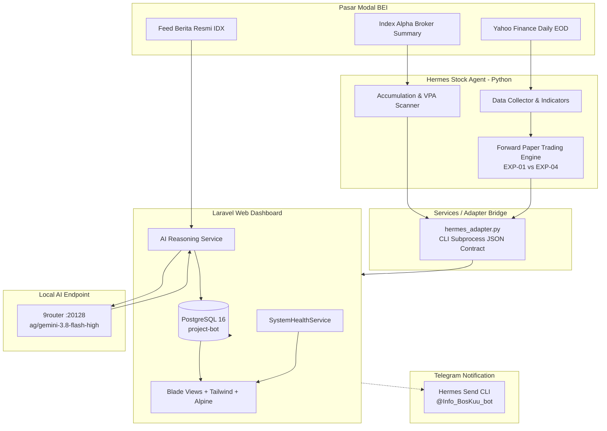

# Hermes Market Intelligence ⚡

Platform intelijen pasar modal Indonesia (Bursa Efek Indonesia / BEI) berbasis integrasi web dashboard, mesin analitik kuantitatif Python, model penalaran AI Gemini 3.8 Flash High, dan notifikasi Telegram terpadu.

> ⚠️ **DISCLAIMER RISET & BATASAN SISTEM:**  
> Sistem ini dibuat semata-mata untuk tujuan riset kuantitatif, otomasi pengolahan data pasar, dan evaluasi strategi perdagangan saham secara simulasi (paper trading). Sistem **TIDAK TERHUBUNG DENGAN BROKER LIVE**, **TIDAK MENGIRIM ORDER SUNGGUHAN**, dan **TIDAK MENJAMIN KEUNTUNGAN FINANSIAL**. Seluruh pengujian strategi masa lalu membuktikan model machine learning murni memiliki ekspektasi negatif setelah memperhitungkan biaya transaksi ritel BEI.

---

## 1. Status Fitur Sistem

| Fitur / Komponen | Status | Deskripsi |
|---|---|---|
| **Laravel Control Plane** | `Implemented` | Dashboard Blade, PostgreSQL 16 connection, 8 core tables, health service. |
| **Blade Views Dashboard** | `Implemented` | Overview, Market Monitor, News & Events, AI History, Health, Settings. |
| **System Health API** | `Implemented` | Real-time diagnostic endpoint di `/api/health` untuk DB, AI router, dan Python path. |
| **Prompt Template Versioning**| `Implemented` | Model Eloquent dan tabel berindeks unik `code + version` untuk prompt LLM. |
| **Hermes Python Engine** | `Implemented` | EOD market scanner, VPA accumulation logic, dan paper trading engine di `E:\hermes-stock-agent`. |
| **Frozen Forward Paper Trading**| `Implemented` | Simulasi portofolio EXP-01 vs EXP-04 dengan akuntansi kas riil dan filter gap. |
| **Hermes CLI Adapter** | `Implemented` | Adapter Python di `services/hermes_adapter.py` untuk jembatan aman ke Laravel. |
| **AI News Ingestion Pipeline** | `Implemented` | Abstraksi konektor berita resmi IDX dan inferensi LLM via 9router lokal (:20128). |
| **BEI Trading Calendar Service**| `Implemented` | Validasi hari bursa resmi 2026 dan finalitas candle EOD (>= 16:00 WIB). |
| **Post-Horizon Evaluator (+5D)**| `Implemented` | Pelacakan dan evaluasi akurasi prediksi AI terhadap return 5 hari bursa berikutnya. |
| **Windows Scheduler Automation**| `Implemented` | Task Scheduler & batch script otomatisasi pada 16:05 WIB dengan proteksi mutex. |
| **Telegram Bridge Idempotency**| `Implemented` | Notifikasi ringkasan pasar dari Laravel memanfaatkan Hermes CLI sender dengan proteksi deduplikasi, mutex lock, dan cooldown. |

---

## 2. Arsitektur Tiga Komponen

Sistem mengintegrasikan tiga pilar modular tanpa ketergantungan melingkar (*no circular dependency*):
1. **Laravel Control Plane (`laravel-app/`):** Web monitoring lokal, manajemen database PostgreSQL, pengelolaan prompt template, serta penjadwalan proses.
2. **Hermes Stock Agent (`E:\hermes-stock-agent/`):** Mesin Python independen untuk kalkulasi teknikal, broker summary bandarmologi, serta simulator paper trading.
3. **Bot Telegram (`@Info_BosKuu_bot`):** Kanal notifikasi resmi langsung ke operator menggunakan Hermes Gateway CLI.

### Diagram Alur Data Sistem (Mermaid)



---

## 3. Struktur Direktori Aktual

```
E:\Project-bot\
├── docs\
│   ├── architecture.md             # Blueprint arsitektur dan skema database
│   ├── contracts.md                # Spesifikasi kontrak baku JSON
│   ├── installation.md             # Petunjuk setup lingkungan
│   ├── PRD.md                      # Product Requirements Document
│   └── STOCK_ANALYSIS_AND_TRAINING.md # Metodologi kuantitatif & audit ML
├── laravel-app\                    # Aplikasi Laravel 13 Control Plane
│   ├── app\
│   │   ├── Http\Controllers\DashboardController.php
│   │   ├── Models\                 # 8 Model Eloquent terindeks
│   │   └── Services\SystemHealthService.php
│   ├── database\migrations\        # Skema migrasi database PostgreSQL
│   ├── resources\views\dashboard\  # Template Blade antarmuka web
│   └── tests\Feature\DashboardTest.php
├── services\                       # Adapter Python & konektor integrasi
│   └── hermes_adapter.py           # Jembatan JSON ke E:\hermes-stock-agent
├── .gitignore                      # Git ignore aman (anti kebocoran secret)
└── README.md                       # Dokumentasi utama proyek
```

---

## 4. Stack Teknologi & Persyaratan Sistem

- **Sistem Operasi:** Windows 11 (64-bit)
- **PHP:** 8.3.7 (Ekstensi aktif: `pdo_pgsql`, `pgsql`, `curl`, `mbstring`, `openssl`)
- **Composer:** 2.8.4
- **Node.js:** v26.7.0 (npm 11.19.0)
- **Database:** PostgreSQL 16.1 (Database: `project-bot`, Host: `127.0.0.1:5432`)
- **Python:** 3.14.7 (Pustaka: `pandas`, `yfinance`, `scikit-learn`, `pytest`)
- **AI Engine:** `ag/gemini-3.8-flash-high` pada router lokal `http://127.0.0.1:20128/v1`
- **Kanal Notifikasi:** Bot Telegram `@Info_BosKuu_bot` via Hermes Gateway

---

## 5. Panduan Instalasi & Konfigurasi

### A. Konfigurasi Lingkungan (`.env`)
Salin file `.env.example` di dalam `laravel-app/`:
```bash
cd E:/Project-bot/laravel-app
cp .env.example .env
php artisan key:generate
```

Pastikan variabel database PostgreSQL terkonfigurasi dengan kredensial lokal Anda:
```ini
APP_NAME="Hermes Market Intelligence"
APP_ENV=local
APP_KEY=base64:...
APP_DEBUG=true
APP_URL=http://localhost:8000

DB_CONNECTION=pgsql
DB_HOST=127.0.0.1
DB_PORT=5432
DB_DATABASE=project-bot
DB_USERNAME=postgres
DB_PASSWORD=your_secure_password_here

HERMES_PYTHON_PATH="C:/Users/ASUS/AppData/Local/hermes/toolchains/python/python.exe"
HERMES_PROJECT_PATH="E:/hermes-stock-agent"
AI_ROUTER_ENDPOINT="http://127.0.0.1:20128/v1"
AI_MODEL_ID="ag/gemini-3.8-flash-high"
```

### B. Migrasi dan Seeder Database
Jalankan migrasi tabel PostgreSQL dan data awal data sources serta prompt template:
```bash
cd E:/Project-bot/laravel-app
php artisan migrate
php artisan db:seed --class=HermesMarketIntelligenceSeeder
```

---

## 6. Cara Menjalankan Sistem

### A. Menjalankan Dashboard Laravel
```bash
cd E:/Project-bot/laravel-app
php artisan serve
```
Aplikasi dapat dibuka melalui peramban web pada: **`http://localhost:8000`**

### B. Menjalankan Pengujian Otomatis (Test Suite)
Untuk menjalankan feature test Laravel:
```bash
cd E:/Project-bot/laravel-app
php artisan test
```
*Status Terkini: 8 tests passing (30 assertions).*

Untuk menjalankan test suite kuantitatif pada Hermes Stock Agent:
```bash
cd E:/hermes-stock-agent
python -m pytest tests/
```
*Status Terkini: 64 master tests passing.*

### C. Memeriksa Status Kesehatan Sistem
Periksa via HTTP endpoint:
```bash
curl http://localhost:8000/api/health
```
Atau buka tab **System Health** pada navigasi web dashboard.

---

## 7. Model AI & Keamanan Kredensial

1. **Model Terkunci:** Sistem dikunci pada model **`ag/gemini-3.8-flash-high`** melalui endpoint lokal `http://127.0.0.1:20128/v1`. Sistem dilarang mengganti model secara otomatis.
2. **Zero Secret Exposure:** File `.env` dikecualikan secara mutlak dari version control melalui `.gitignore`. Kredensial tidak pernah dicetak dalam log, prompt teks, view dashboard, maupun laporan hasil.

---

## 8. Referensi Dokumentasi Lengkap

- [Dokumen Spesifikasi Produk (PRD.md)](docs/PRD.md)
- [Metodologi Analisis Saham & Training Model (STOCK_ANALYSIS_AND_TRAINING.md)](docs/STOCK_ANALYSIS_AND_TRAINING.md)
- [Panduan Operasional & Penjadwalan Windows (WINDOWS_OPERATIONS.md)](docs/WINDOWS_OPERATIONS.md)
- [Arsitektur Sistem (architecture.md)](docs/architecture.md)
- [Kontrak Baku JSON (contracts.md)](docs/contracts.md)
- [Panduan Instalasi Detail (installation.md)](docs/installation.md)
