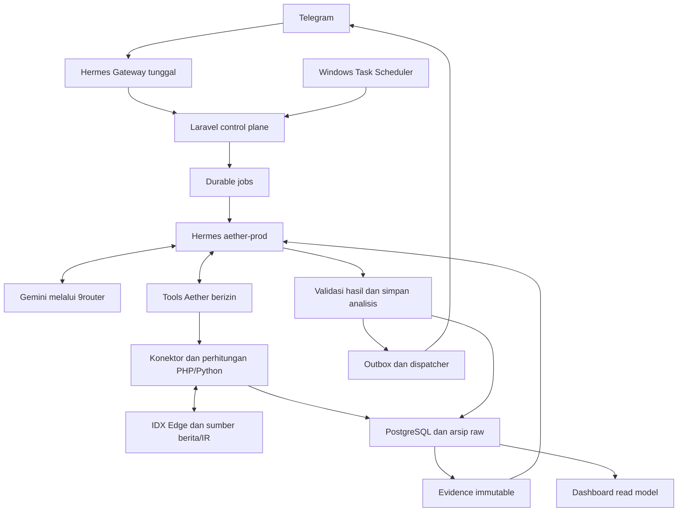
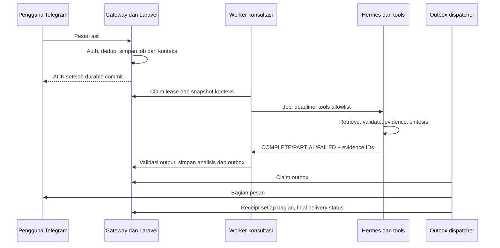
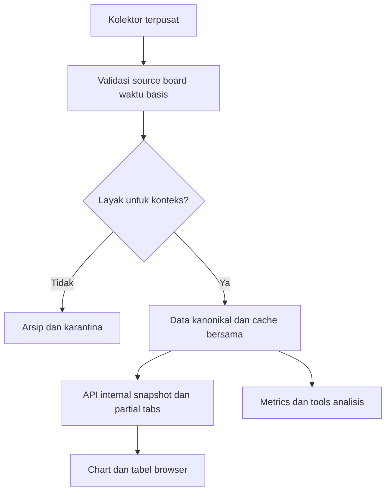
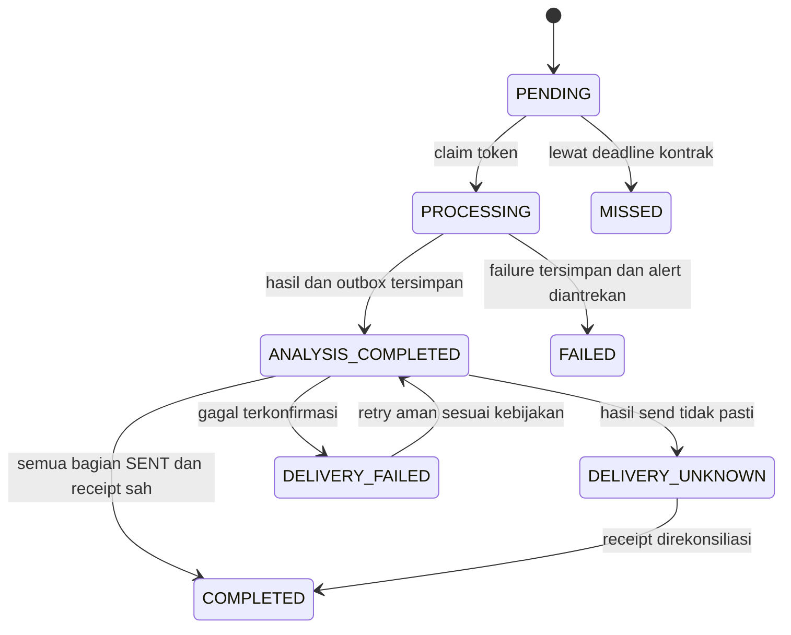

# Arsitektur Kanonikal Aether v3

31 Oktober 2026 • Target arsitektur. Nama service/command berasal dari laporan pengguna dan perlu dicocokkan dengan repository saat implementasi. Diagram konseptual bukan bukti foreign key atau deployment.

## 1. Batas sistem dan tanggung jawab

| Komponen | Tanggung jawab | Bukan tanggung jawab |
|---|---|---|
| Hermes Gateway default | Satu receiver Telegram, receipt inbound, routing ringan dan ACK/transport | Retrieval/LLM panjang di handler |
| Laravel control plane | Auth, konteks, durable jobs, budget, tool executor, evidence, publication, monitor, UI/API | Mengarang data/model verdict |
| Hermes aether-prod | Planning, memilih tool allowlist, sintesis dengan Gemini melalui9router | Receiver kedua, shell bebas, publish sendiri, fetch melewati kontrol |
| PHP/Python services | Konektor, validasi, deterministic analytics, inferensi/riset ML | Menulis fakta dari teks LLM |
| PostgreSQL + raw archive | Versi data, provenance, evidence, job/outbox/outcome | Cache dianggap sebagai fakta terbaru tanpa cutoff |
| IDX Edge | Harga/histori/broker/fundamental sesuai endpoint | API resmi BEI atau broker execution |
| News/IR sources | Artikel dan dokumen yang berhasil diperoleh | Klaim tidak ada berita global hanya karena cache kosong |
| Browser Laravel | Read model, chart, eksplisit request analysis | Memegang key atau provider polling per viewer |

Hermes Agent pengembang (tools file/shell) terpisah dari Hermes reasoning production. Model tetap alias `ag/gemini-3.8-flash-high`; mapping aktual di9router dicatat bila tersedia. Hermes adalah orchestrator, bukan model pengganti Gemini. Tidak ada n8n.

## 2. Komponen runtime

Semua request tools melalui layanan Aether, termasuk jika expose melalui MCP tipis. MCP provider langsung tidak boleh menjadi bypass budget/cache/quarantine pada profil produksi. Pilih adapter yang benar-benar didukung runtime lokal; CLI flags di laporan harus diverifikasi dengan help versi terpasang. Profil produksi Telegram disabled, tools development disabled, hanya tools aplikasi aktif. Akses news diizinkan melalui tool retrieval terbatas, bukan browser/shell bebas.

## 3. Alur chat tanpa blocking

Follow-up cakupan/sumber/arti angka memuat analisis sebelumnya. Tidak otomatis rerun screening. Request dengan update sama didedup; pesan baru berteks sama tetap update baru, tetapi hasil/tools bisa memakai cache fresh. Jika sudah ada job setara berjalan, tautkan secara eksplisit sesuai kebijakan, jangan membuat inferensi paralel tersembunyi. Recovery mempertahankan inbound asli dan recovery attempt terpisah, tidak membuat synthetic update untuk klaim live.

## 4. Data pipeline dan chart

Ingestion memeriksa source permission, endpoint quality, calendar, freshness, periode dan kebutuhan histori. Raw response disimpan dengan hash dan metadata sebelum angka dipakai. Validasi angka/schema/board/date/basis -> versioned canonical observations -> metrics. Tools menyimpan evidence sebelum mengembalikan payload ringkas ke agent. Evidence tidak diubah setelah analisis; koreksi membuat versi dan hubungan supersedes.

Chart tidak melewati LLM. Polling internal30 detik bukan realtime provider. Intraday baru dibuka setelah RG, latency, pagination/kelengkapan, transaksi koreksi, unit dan kuota diverifikasi; done_details adalah kandidat penelitian, bukan feed siap produksi. Harga NG sah sebagai transaksi board terpisah namun tidak layak menjadi quote RG.

## 5. Worker dan single ownership

| Pekerjaan | Owner target dari laporan terakhir |
|---|---|
| Konsultasi, research, user schedules, outbox | Laravel scheduler dipicu task dispatcher1 menit |
| Ingestion/backfill berat dan narasi batch | run_aether_workers.bat5 menit, lock terpisah |
| Probe EOD16:05 | Task HermesMarketIntelligence_EOD, tanpa jadwal Laravel duplikat |
| Briefing08:30 dan recap20:00 | Laravel scheduler + kalender bursa |

Single owner berarti tidak dipicu dua runner. Consultation dan outbox boleh proses paralel dengan concurrency terbatas dan mutex independen. Lock backfill tidak memblokir chat. DB transaction singkat untuk claim/finalize; tidak menahan transaksi saat HTTP/LLM/subprocess. Session context lock per user/conversation dan queue order mencegah dua jawaban memutasi konteks bersamaan. Absolute deadline mencakup lock wait, bootstrap, tool, retry dan sintesis. Heartbeat aktual selama pekerjaan; lease owner token diperiksa atomik pada write. PID creation identity diperiksa sebelum recovery; jangan membunuh proses berdasarkan PID saja.

## 6. State machine target

Agent result: COMPLETE/PARTIAL/FAILED. AnalysisRun dapat selesai walau output PARTIAL jika batas data jujur; bukan berarti semua data lengkap.

State di atas logis; mapping ke kolom existing `status`, `delivery_status`, `analysis_completed_at` harus eksplisit. Jangan mengubah enum produksi tanpa migrasi/test. Pesan multipart simpan receipt perpart, partial failure tidak menjadikan seluruh outbox SENT. Delivery UNKNOWN tidak blind retry. Outbox SENT immutable; koreksi berupa erratum baru.

## 7. Model data konseptual

| Entitas/tabel existing yang dilaporkan | Kontrak |
|---|---|
| idx_company_registries | Identitas, source registry, instrument_type, alias; bukan bukti listing aktif hanya dari simbol feed |
| market_observations | Kanonikal versi bar sesuai provider/board/timeframe/adjustment; arsip Yahoo tetap terpisah |
| market_snapshots | Legacy/read projection jika masih dipakai; tidak boleh menjadi jalur fakta kedua |
| company_analysis_metrics | Input range/count, formula/version, source hashes dan status sufficiency |
| company_fundamentals | Periode, currency,scale,attribution,document/provider provenance, revisions |
| broker_summaries | Ticker,actual period,broker,board,net/gross,coverage/source/version |
| data_revision_archives | Before/after hashes dan payload, alasan,waktu, hubungan revision |
| evidence_snapshots | Immutable raw refs dan subset fakta yang dipakai; first seen/cutoff tercatat |
| analysis_runs / market_analyses | Job, result, prompt/tool/model/config versions, evidence links, PARTIAL reason |
| telegram_conversations / scheduled_telegram_jobs | Inbound dedup,context,user/job/deadline/lease/recovery |
| telegram_outbox | Payload immutable setelah sent,part receipts,delivery attempts |
| prediction_signals / monitoring_events | Origin RULE/AGENT/ML, aturan horizon,outcome terpisah |
| user_watchlists / user_portfolios | Isolasi user; posisi input eksplisit, tanpa broker order |

Ini bukan ERD migrasi aktual. Periksa unique/FK existing sebelum menambah: broker agregat rentang perlu start/end bukan hanya satu summary_date; source/board/adjustment/revision identity jangan hilang. Alias indeks dinormalisasi ke satu instrument_id. Logical links string lama tidak disebut FK jika constraint tidak ada.

## 8. Keamanan, observability, rollback

Key server-side melalui env/profile secret, tidak di browser/prompt/log. Semua tool args schema-validated dan ticker resolved; kalender/URL/download dibatasi, ukuran konten dibatasi, konten dokumen/news dianggap data tidak tepercaya dan tidak boleh mengubah instruksi tools. Tool writes portofolio memerlukan intent perubahan eksplisit, bukan efek samping analisis.
Correlation: inbound/update -> conversation -> job/attempt -> tool execution/request/raw/evidence -> analysis -> outbox/parts -> receipt -> monitoring. Log mencatat HTTP count dan quota units terpisah; koneksi reachable terpisah completion success. Jangan simpan reasoning_content/CoT atau secret dalam payload pengguna.
Feature flag orchestrator dengan rollback ke jalur lama hanya melalui konfigurasi operator, bukan fallback otomatis per job yang menggandakan penalaran. Rollback tidak menghapus evidence/outbox atau mengulang delivery. Data source disable tidak mengaktifkan Yahoo diam-diam.
